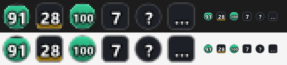

# Claude Usage Tray

Two tiny Windows tray icons that show how much of your **Claude** plan limit is left — right on the taskbar, no hovering needed.



| Icon | Limit |
|---|---|
| ● circle | 5-hour session limit |
| ■ square | weekly limit |

- The number is the **% still available**; the fill level shows the same thing visually.
- Color: green ≥ 50 %, amber 20–49 %, red < 20 %. Grey `?` = data couldn't be loaded.
- Hover → reset time (e.g. "za 2 d 21 h (po 05:59)").
- Left click → refresh, double click → open claude.ai/settings/usage, right click → menu.
- Refreshes every 5 minutes. UI text is in Czech.

## Requirements

- Windows 10/11
- [PowerShell 7](https://learn.microsoft.com/powershell/scripting/install/installing-powershell-on-windows) (`pwsh`)
- Signed in to [Claude Code](https://claude.com/claude-code) (CLI or desktop app) with a Claude Pro/Max subscription — the script reads the OAuth token from `%USERPROFILE%\.claude\.credentials.json`.

## Install

```powershell
git clone https://github.com/invertedburger/claude-usage-tray.git
cd claude-usage-tray
pwsh -ExecutionPolicy Bypass -File .\install.ps1
```

This copies the script to `%LOCALAPPDATA%\ClaudeUsageTray`, adds a shortcut to your Startup folder and starts it. Run it again to update.

Windows 11 hides new tray icons under the **^** arrow — drag them onto the taskbar once and they stay there.

## Uninstall

```powershell
pwsh -ExecutionPolicy Bypass -File .\uninstall.ps1
```

## How it works

Every 5 minutes it calls `https://api.anthropic.com/api/oauth/usage` (the same data claude.ai shows under *Settings → Usage*) with your Claude Code OAuth token and redraws the icons with `System.Drawing`. The token never leaves your machine except in that request to Anthropic.

This endpoint is **undocumented** and may change without notice. The access token expires periodically; Claude Code / the desktop app refreshes it whenever you use them — until then the icons show `?`.

## License

MIT
